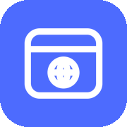
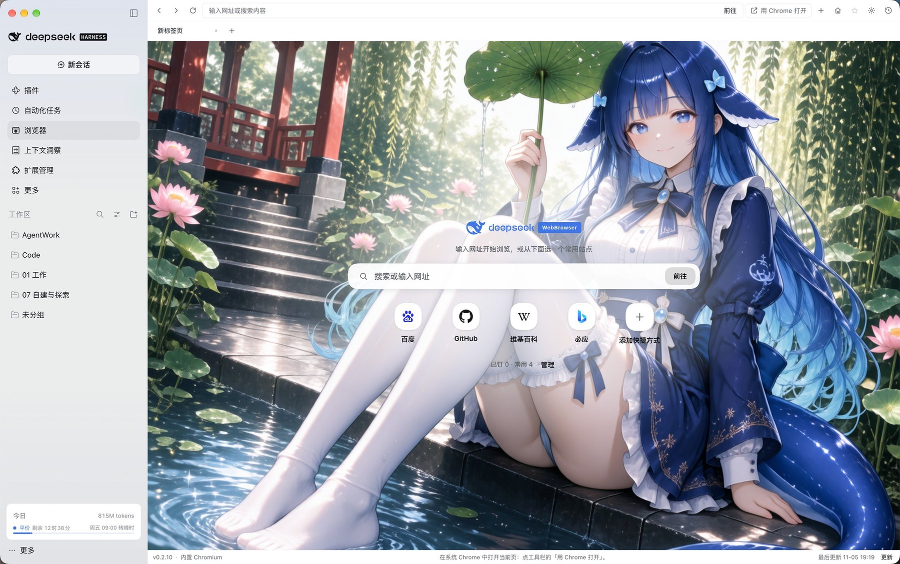
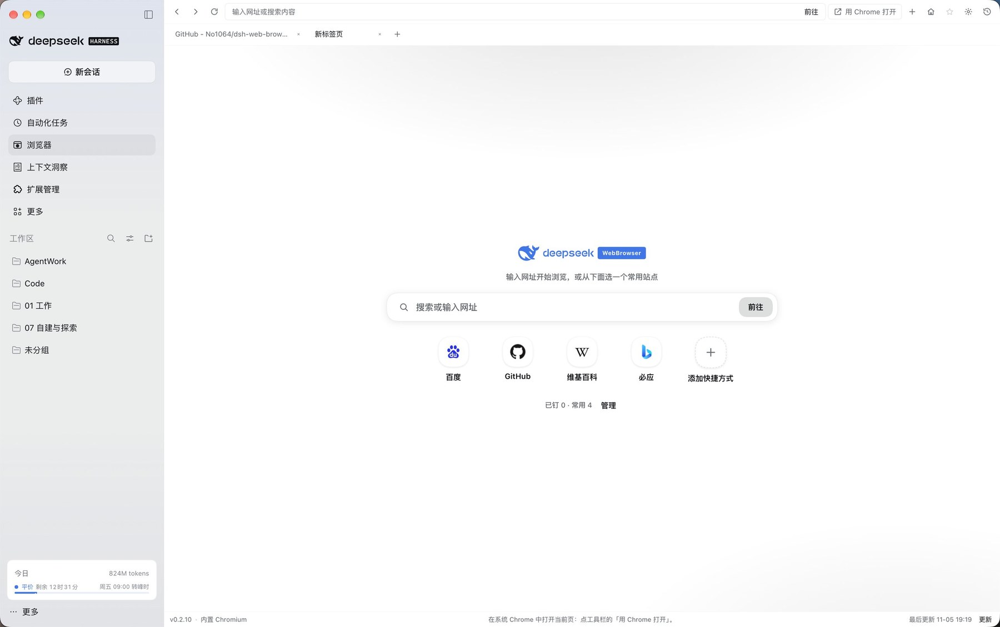
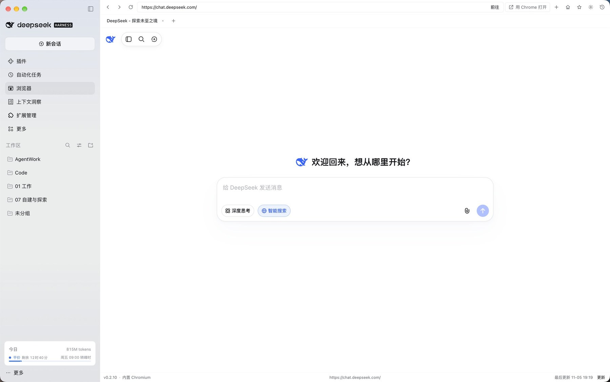

<div align="center">
  <h1>
     dsh-web-browser
  </h1>
  <p>
    <b>A full-page browser panel for DeepSeek Harness Desktop: tabs, address bar, context menu, pinned homepage and browsing history</b>
  </p>
  <p>
    <b>DeepSeek Harness Desktop 的整页浏览器面板：多标签、地址栏、右键菜单、主页常用网址与浏览历史</b>
  </p>
  <p>
    <a href="https://github.com/No1064/dsh-web-browser/stargazers"></a>
    <a href="https://github.com/No1064/dsh-web-browser/forks"></a>
    <a href="https://www.npmjs.com/package/dsh-web-browser"></a>
    <a href="https://www.npmjs.com/package/dsh-web-browser"></a>
    <a href="LICENSE"></a>
    
  </p>
  <p>
    <a href="README.md">简体中文</a> | <b>English</b>
  </p>
  <p>
    <a href="#features">Features</a> &nbsp;|&nbsp;
    <a href="#screenshots">Screenshots</a> &nbsp;|&nbsp;
    <a href="#installation">Installation</a> &nbsp;|&nbsp;
    <a href="#usage">Usage</a>
  </p>
</div>



Adds a **Browser** entry to the DeepSeek Harness Desktop feature menu. Clicking it opens a full-page browsing panel in the main content area for websites and external links. Unlike the built-in single-page browser in DSH's right sidebar, this plugin occupies the whole main content area and implements tabs, pinned homepage shortcuts, a dedicated history page and a context menu.

> 💡 **Human-only**: the plugin registers no AI-facing tools, prompts or session events.

> ⭐ If this plugin helps you, a Star helps more people find it.

## Features

- **Full-page panel**: opens from the left feature menu and fills the main content area; you can switch back and forth with other panels.
- **Tabs**: open several pages and switch between them; tabs and URLs persist across restarts.
- **Address bar**: type a URL to open it, or plain text to search; back, forward, reload and stop; new-window requests open as tabs.
- **Context menu**: cut / copy / paste / select all; open links and images in a new tab, copy their addresses, or open them in Chrome; plus back, forward, reload, copy page URL and zoom in / out / reset.
- **Homepage and quick links**: configure the homepage and new-tab behavior; add, edit and pin shortcuts on the start page; pin the current page with the toolbar star; the start page background can be the default gradient, a solid color, an image URL or a local image.
- **History**: a dedicated page with search, date grouping, single-entry deletion and clear-all, 200 entries per page with "show more", stored permanently in IndexedDB and removed only when you clear it.
- **Open in Chrome**: hand the current page over to your system Chrome from the toolbar.
- **Theme and language**: follows DSH's light / dark theme and Chinese / English UI.
- **Persistence**: tabs, the current page and homepage settings are stored locally and restored after a restart.

## Screenshots

**Start page**



**Browsing**



## Installation

Install from npm (recommended — prebuilt artifacts skip the `allowBuilds` approval):

```bash
dsh plugin --profile desktop add dsh-web-browser
```

Or install directly from GitHub:

```bash
dsh plugin --profile desktop add github:No1064/dsh-web-browser
```

Restart DSH after installing to load the plugin.

## Usage

1. Click the **Browser** icon in the top-left feature menu to open the full-page panel.
2. Enter a URL or a search term in the address bar and press Enter.
3. Create a tab when you need to browse in parallel and switch between tabs at any time.
4. Add shortcuts on the start page, or pin the current page with the toolbar star.
5. Open the history page from the toolbar to view, search and clean up your browsing history.
6. Use **Open in Chrome** when you want to continue in your system Chrome.

## Requirements

- **DSH Desktop**: the built-in engine relies on the desktop webview bridge.

## Development

`client.js` is a build artifact generated from `src/` and committed to the repository (no build step at install time):

```bash
node scripts/build.mjs     # src/core.js + src/features/*.js → client.js
node --check client.js     # syntax check
```

Make changes under `src/`; when the plugin is installed through a local symlink, rebuild and **restart DSH** (the host caches client bundles at startup, so reloading the page is not enough). `src/FEATURES.md` documents the feature-file contract and available extension points.

## Project structure

```
dsh-web-browser/
├─ README.md                     # Chinese README
├─ README.en.md                  # English README
├─ LICENSE
├─ package.json                  # dsh.bundle.patch + dsh.client
├─ cordis.patch.yml              # bundle patch layer
├─ index.js                      # host half
├─ client.js                     # build artifact
├─ icon.svg
├─ assets/icon-180.png           # raster icon
├─ screenshots/                  # README screenshots
├─ locale/{zh,en}.json
├─ src/
│  ├─ core.js                    # panel core: entry / tabs / address bar / engine / extension points
│  ├─ FEATURES.md                # feature contract
│  └─ features/
│     ├─ 30-context-menu.js      # context menu
│     ├─ 50-home-bookmarks.js    # homepage / quick links / pinning
│     └─ 70-history.js           # browsing history
└─ scripts/build.mjs             # build script
```

## License

[MIT](LICENSE)
