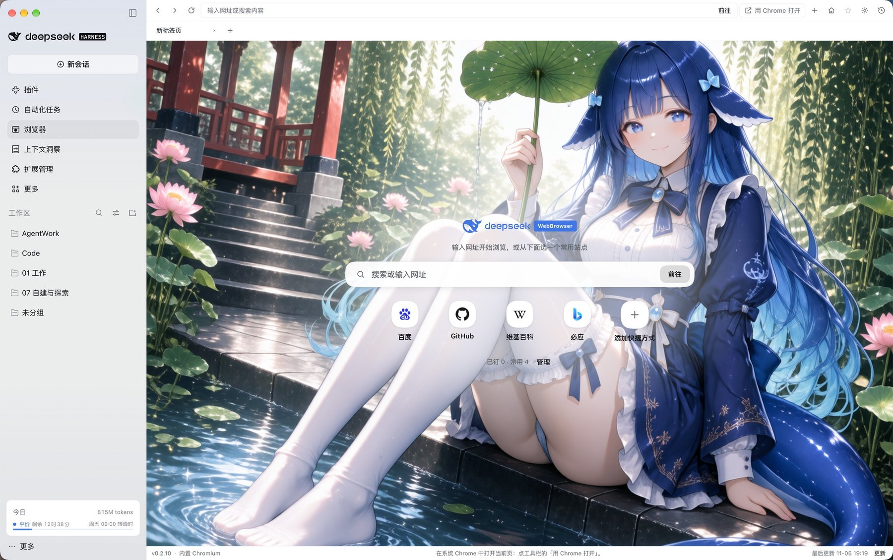
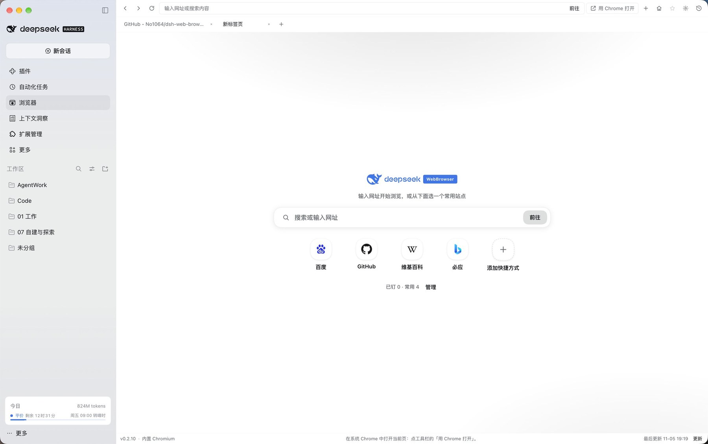
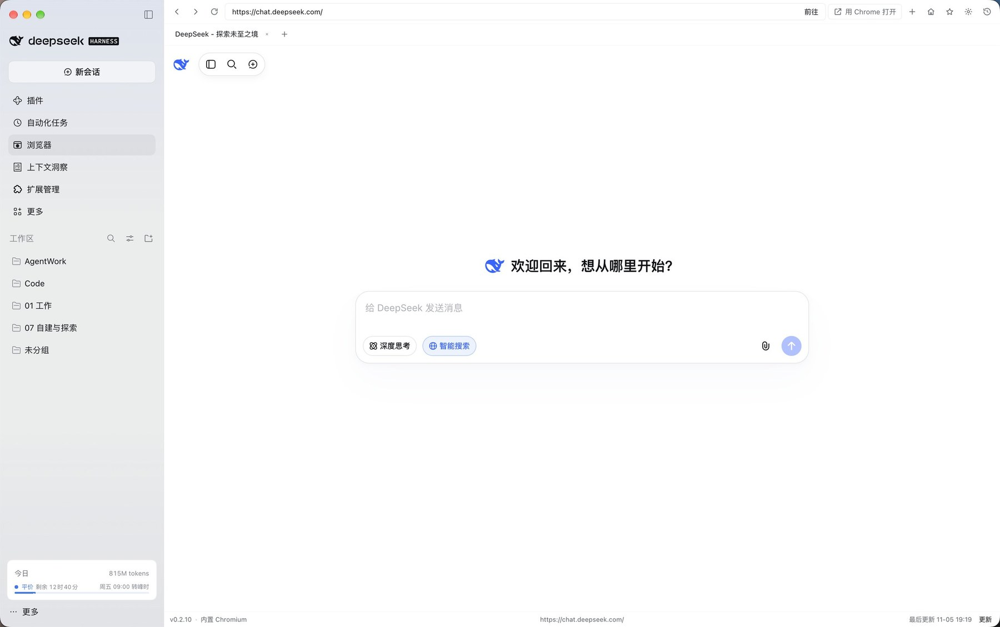

<div align="center">
  <h1>
     dsh-web-browser
  </h1>
  <p>
    <b>DeepSeek Harness Desktop 的整页浏览器面板：多标签、地址栏、右键菜单、主页常用网址与浏览历史</b>
  </p>
  <p>
    <b>A full-page browser panel for DeepSeek Harness Desktop: tabs, address bar, context menu, pinned homepage and browsing history</b>
  </p>
  <p>
    <a href="https://github.com/No1064/dsh-web-browser/stargazers"></a>
    <a href="https://github.com/No1064/dsh-web-browser/forks"></a>
    <a href="https://www.npmjs.com/package/dsh-web-browser"></a>
    <a href="https://www.npmjs.com/package/dsh-web-browser"></a>
    <a href="LICENSE"></a>
    
  </p>
  <p>
    <b>简体中文</b> | <a href="README.en.md">English</a>
  </p>
  <p>
    <a href="#功能">核心功能</a> &nbsp;|&nbsp;
    <a href="#界面">界面</a> &nbsp;|&nbsp;
    <a href="#安装">安装</a> &nbsp;|&nbsp;
    <a href="#使用">使用</a>
  </p>
  <p align="center">
    
  </p>
</div>

在 DeepSeek Harness Desktop 左上角功能菜单新增「浏览器」入口，点击后在右侧主内容区整页浏览网页与外部链接。与 DSH 自带的右侧栏单页浏览器不同，本插件占据主内容区整页，并把多标签、主页快捷入口、收藏钉住、独立历史页和右键菜单做完整。

> 💡 **只给人用**：不向 AI 注册任何工具、提示词或会话事件。

> ⭐ 如果这个插件对你有帮助，欢迎点个 Star，帮助更多人发现它。

## 功能

- **整页面板**：从左侧功能菜单进入后占据主内容区整页，可与其他主面板来回切换。
- **多标签**：可同时打开多个页面并在标签间切换，标签与 URL 会持久化，重启后可恢复。
- **地址栏**：输入 URL 直接打开，输入普通文字则按搜索引擎搜索；支持前进、后退、刷新、停止，页面发起的新窗口请求会转为新标签页。
- **右键菜单**：复制 / 剪切 / 粘贴 / 全选；链接与图片可「在新标签页打开」「复制地址」「用 Chrome 打开」；以及后退 / 前进 / 刷新 / 复制当前网址 / 放大 / 缩小 / 重置缩放。
- **主页与常用网址**：可设置主页与新标签页行为；起始页提供快捷入口，可增删改、钉住置顶；工具栏星标可一键钉住当前页；起始页背景可选默认渐变、纯色、图片 URL 或本地图片。
- **浏览历史**：独立历史页，支持搜索、按日期分组、单条删除、清空，每页 200 条并可「显示更多」，数据写入 IndexedDB 永久保存，仅在手动清理时删除。
- **用 Chrome 打开**：工具栏可把当前页交给系统 Chrome 打开。
- **主题与语言**：跟随 DSH 的浅色 / 深色主题与中英文界面。
- **状态持久化**：标签、当前页与主页配置写入本地存储，重启后可恢复。

## 界面

**起始页**



**浏览页**



**自定义起始页**


## 安装

从 npm 安装（推荐，预构建产物免 `allowBuilds` 授权）：

```bash
dsh plugin --profile desktop add dsh-web-browser
```

或直接从 GitHub 安装：

```bash
dsh plugin --profile desktop add github:No1064/dsh-web-browser
```

安装后重启 DSH 以加载插件。

## 使用

1. 点左上角功能菜单里的「浏览器」图标，进入整页面板。
2. 在地址栏输入网址或搜索词，回车打开。
3. 需要并行浏览时新建标签，标签间可随时切换。
4. 常用的站点在起始页添加快捷方式，或用工具栏星标钉住当前页。
5. 点工具栏的历史图标查看、搜索和清理浏览记录。
6. 需要时可用工具栏的「用 Chrome 打开」在系统 Chrome 中继续浏览。

## 环境要求

- **DSH Desktop**：内置引擎依赖桌面端的 webview 桥。

## 开发

`client.js` 是构建产物，由 `src/` 拼装生成并提交到仓库（安装期不做构建）：

```bash
node scripts/build.mjs     # src/core.js + src/features/*.js → client.js
node --check client.js     # 语法校验
```

改动写在 `src/` 下；本地以软链方式安装时，重新构建后**重启 DSH** 生效（宿主在启动时缓存客户端包，只刷新页面不够）。`src/FEATURES.md` 说明 feature 文件的契约与可用扩展点。

## 目录结构

```
dsh-web-browser/
├─ README.md                     # 中文说明
├─ README.en.md                  # English README
├─ LICENSE
├─ package.json                  # dsh.bundle.patch + dsh.client
├─ cordis.patch.yml              # bundle patch 层
├─ index.js                      # Host 半
├─ client.js                     # 构建产物
├─ icon.svg
├─ assets/icon-180.png           # 位图图标
├─ screenshots/                  # README 截图
├─ locale/{zh,en}.json
├─ src/
│  ├─ core.js                    # 面板核心：入口 / 标签 / 地址栏 / 引擎 / 扩展点
│  ├─ FEATURES.md                # feature 契约
│  └─ features/
│     ├─ 30-context-menu.js      # 右键菜单
│     ├─ 50-home-bookmarks.js    # 主页 / 常用网址 / 钉住
│     └─ 70-history.js           # 浏览历史
└─ scripts/build.mjs             # 构建脚本
```

## 许可

[MIT](LICENSE)
